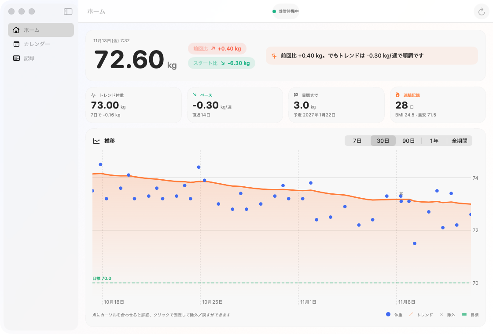
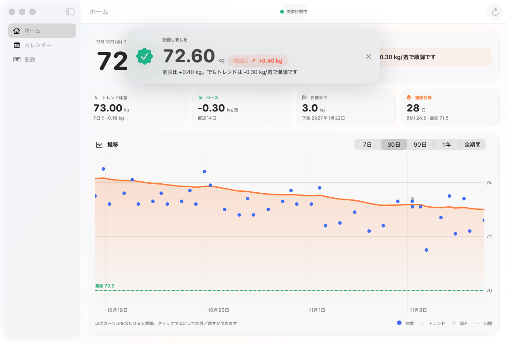
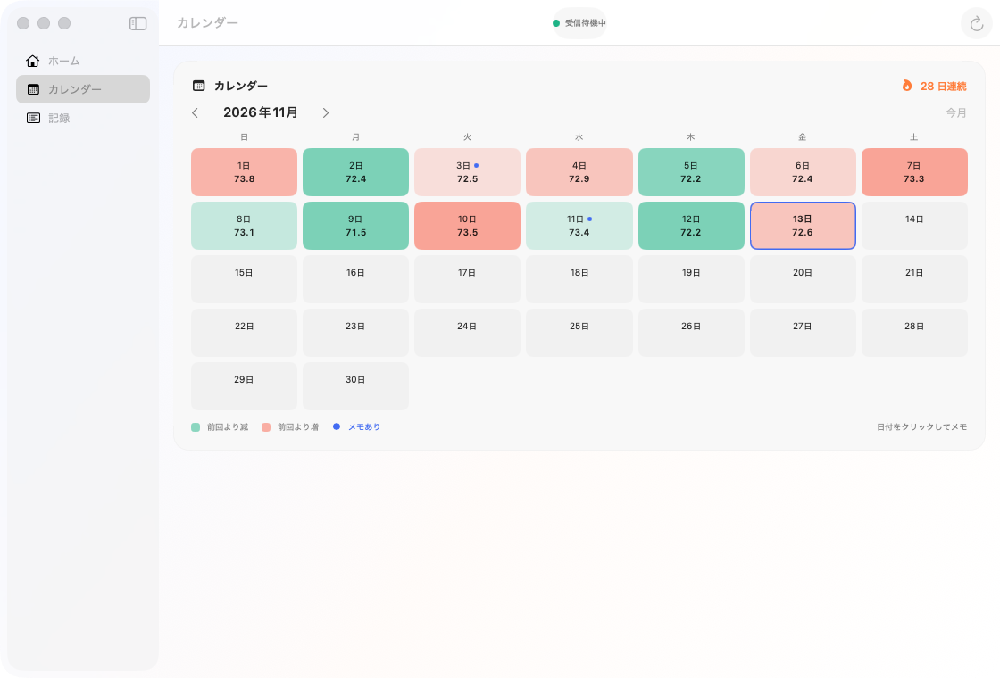
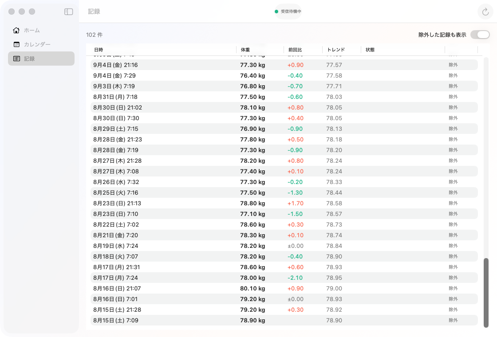
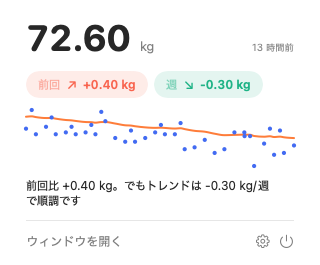
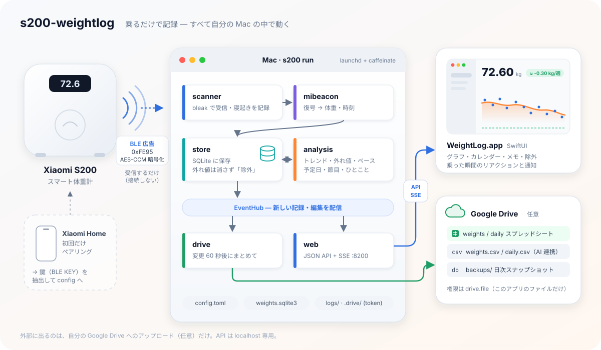

# s200-weightlog — Xiaomi Smart Scale S200 を Mac で自動記録

Xiaomi スマート体重計 S200 が Bluetooth LE で発信する計測値（暗号化された MiBeacon 広告）を Mac で受信・復号し、
SQLite に自動で記録します。体重計とは接続しない**パッシブ受信**なので、体重計の電池や Xiaomi Home アプリの動作に影響しません。

<picture>
  <source media="(prefers-color-scheme: dark)" srcset="docs/images/home-dark.png">
  
</picture>

- **乗るだけで記録**：常駐プログラムがバックグラウンドで受信。家族が乗った・荷物を持ったなどの外れ値は自動で除外（戻せる）
- **Mac アプリ**（SwiftUI）：トレンド体重・週あたりのペース・目標到達予定日・カレンダーとメモ。乗った瞬間にリアクションと通知、メニューバーに最新値
- **Google Drive 連携**（任意）：スプレッドシート・CSV・日次バックアップを自分の Drive に自動アップロード
- **ローカル API**：`http://127.0.0.1:8200` の JSON API と SSE。ほかのツールからも使える

| 乗った瞬間 | カレンダーとメモ | 記録と除外 |
|---|---|---|
|  |  |  |



メニューバーにも最新の体重とトレンドの矢印が常に出ていて、クリックするとミニグラフとひとことが見られます。

画面の数値はすべてダミーデータです（[`scripts/screenshots.sh`](scripts/screenshots.sh) で再生成できます）。

<br clear="right">

## しくみ



詳しい設計は [docs/architecture.md](docs/architecture.md)、体重計のプロトコルは [docs/protocol.md](docs/protocol.md) を参照してください。

## 必要なもの

| | |
|---|---|
| 体重計 | Xiaomi Smart Scale S200（`xiaomi.scales.ms114` で動作確認。product id `0x4DCC`） |
| Mac | macOS 15 以降、Bluetooth 搭載（常時起動できる Mac mini などが向いています） |
| スマホ | 初回のペアリングだけ Xiaomi Home アプリが必要 |
| ツール | [uv](https://docs.astral.sh/uv/)（Python 3.13 は uv が用意します）。アプリをビルドする場合は Xcode 16 以降と [XcodeGen](https://github.com/yonaskolb/XcodeGen)（`brew install xcodegen`） |

## セットアップ

### 1. 体重計の鍵（BLE KEY）と MAC アドレスを取得する

体重データは体重計ごとの鍵で暗号化されているので、最初に鍵を取り出します。

1. スマホの **Xiaomi Home** アプリで S200 を追加（ペアリング）する。選んだサーバー地域（日本なら通常 `jp`）を控えておく
2. [Xiaomi-cloud-tokens-extractor](https://github.com/PiotrMachowski/Xiaomi-cloud-tokens-extractor) を実行し、Xiaomi アカウントでログインする
3. 出力の体重計の項目から 2 つを控える
   - **BLE KEY**：32 桁の16進数（`TOKEN` は 24 桁の別物。取り違えに注意）
   - **MAC**：`AA:BB:CC:DD:EE:FF` 形式（macOS は実アドレスを隠すので手入力が必要）

> 体重計をリセットして再ペアリングすると BLE KEY は変わります。そのときは取り直してください。

### 2. インストールと設定

```bash
git clone https://github.com/tkys/s200-weightlog.git
cd s200-weightlog
uv sync
cp config.example.toml config.toml   # config.toml は git 管理外
```

`config.toml` に `bindkey`（BLE KEY）と `mac` を記入します。身長・目標体重はあとでアプリからも変更できます。
家族で 1 台を使う場合は、`profile_id` に自分のユーザー番号を入れると自分の記録だけが残ります（番号は記録のログで確認できます）。

### 3. 受信を確認する

```bash
uv run s200 scan --seconds 60
```

実行中に体重計に乗ってください。`product=0x4dcc`（機種により `0x4c04` / `0x4dcb` / `0x45c9`）の行が流れれば受信できています。
初回は macOS が Bluetooth の利用許可を求めるので許可します（システム設定 → プライバシーとセキュリティ → Bluetooth）。

> **iPhone などで Xiaomi Home アプリが Bluetooth を使える状態だと、計測値をスマホが先に受け取り、Mac に届かないことがあります。**
> スマホの設定で Xiaomi Home の Bluetooth 許可をオフにしてください。

### 4. 常駐させる

まずはターミナルで動かして、乗ったら記録されることを確認します。

```bash
uv run s200 run
# INFO recorded 70.80 kg (profile 1) at 2026-11-13 07:52:27 [ok]
```

確認できたら Ctrl+C で止め、ログイン時に自動で起動する常駐（launchd）として登録します。

```bash
scripts/launchd.sh install     # 登録して起動
scripts/launchd.sh status      # 動作確認
tail -f logs/s200.log          # ログ
scripts/launchd.sh restart     # コードや config.toml を変えたとき
scripts/launchd.sh uninstall   # 解除
```

常駐中は `caffeinate -i` で **Mac のアイドルスリープを止めます**（スリープ中は Bluetooth を受信できず、記録が抜けるため）。ディスプレイは通常どおりスリープします。

### 5. Mac アプリをビルドする（任意）

```bash
cd app
xcodegen generate
xcodebuild -project WeightLog.xcodeproj -scheme WeightLog -derivedDataPath build build
open build/Build/Products/Debug/WeightLog.app
```

署名は「ローカルで実行」用（ad-hoc）なので、Apple Developer アカウントは不要です。
アプリの設定（⌘,）で身長・目標・スタート体重、ログイン時の起動を設定できます。通知は初回起動時に許可してください。

### 6. Google Drive 連携（任意）

記録を自分の Google Drive の「体重ログ」フォルダに自動でアップロードします。Google Cloud で OAuth クライアントを作る初期設定（10〜15 分）が必要です。
手順は [docs/google-drive.md](docs/google-drive.md) を参照してください。

## 使い方

- 体重計に乗るだけです。数秒〜2 分ほどでアプリに反映されます（体重計の時計が少し遅れていることがあります）
- **外れ値**：トレンドから大きく離れた記録（家族・荷物など）は自動で「除外」され、グラフや平均に使われません。アプリの「記録」画面やグラフの点から戻せます。10 分以内に乗り直した場合は最後の 1 回だけが残ります
- **メモ**：カレンダーの日付をクリックすると、その日のメモとタグ（飲み会・運動など）を残せます

## トラブルシュート

| 症状 | 確認すること |
|---|---|
| `scan` に何も出ない | 体重計に乗って数値が確定するまで待つ／Mac との距離／Bluetooth の許可 |
| 広告は出るが記録されない | BLE KEY と TOKEN の取り違え、MAC の誤り、再ペアリングで鍵が変わっていないか。ログに `could not be decrypted` が出ていれば鍵か MAC が違う |
| 乗ったのに記録されないことがある | `logs/s200.log` の乗った時刻に `scale awake` があるか。無ければ信号が Mac に届いていない（スマホの Xiaomi Home が先に受け取った、Mac がスリープしていた） |
| launchd では受信できない | ターミナルで `uv run s200 run` を一度実行して Bluetooth を許可してから `scripts/launchd.sh restart` |
| アプリに「未接続」と出る | 常駐が動いているか（`scripts/launchd.sh status`）、`curl http://127.0.0.1:8200/api/summary` が返るか |
| Drive に上がらない | [docs/google-drive.md](docs/google-drive.md#トラブルシュート) |

ログの見方：`scale awake`（体重計が起きた＝誰かが乗った）、`recorded`（記録した）、`heartbeat`（1 時間ごとの受信数）、`drive sync`（アップロード）。
体重計は 50 分ごとに状態通知（object `0x6623`）も送りますが、これは体重ではないので記録しません。

## ファイル構成

```
s200/            Python 常駐（受信・復号・保存・分析・API・Drive）
tests/           pytest
app/             SwiftUI アプリ（XcodeGen の project.yml）
launchd/         LaunchAgent のテンプレート
scripts/         launchd の登録、ダミーデータと画面写真の生成
docs/            設計・プロトコル・Drive 手順、GitHub Pages（紹介ページとプライバシーポリシー）
config.example.toml
```

実行時に作られるもの（すべて git 管理外）：`config.toml`、`weights.sqlite3`（記録）、`logs/`、`backups/`、`.drive/`（Google の認証情報）。

## 開発

```bash
uv run pytest          # Python のテスト（実機の暗号化パケットで復号を検証）
uv run ruff check .
cd app && xcodegen generate && xcodebuild -project WeightLog.xcodeproj -scheme WeightLog -derivedDataPath build test
scripts/screenshots.sh # README の画面写真をダミーデータで作り直す
```

## 謝辞・参考

プロトコルの解析は [Bluetooth-Devices/xiaomi-ble](https://github.com/Bluetooth-Devices/xiaomi-ble) などの先行実装に負っています（一覧は [docs/protocol.md](docs/protocol.md#参考実装)）。
本プロジェクトは Xiaomi とは無関係の非公式ツールです。

## ライセンス

[MIT](LICENSE)
